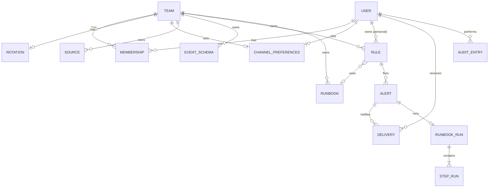

# PagerCutie — Domain model and management API

The entities, their permissions and lifecycles, and the management API the frontend talks to.
Architecture and contracts in general are in [SPEC.md](SPEC.md); requirement IDs refer to
[REQUIREMENTS.md](REQUIREMENTS.md).

**The contract is the code.** Every entity below is a Pydantic DTO in `backend/src/pagercutie/<module>/schemas.py`
and every endpoint a FastAPI route. `mise run contract` exports them to `contract/openapi.json` (plus
`contract/rule.schema.json` and `contract/runbook.schema.json`), and `mise run api` also generates the TypeScript
client from it. If this document and the DTOs disagree, the DTOs win; fix this document.

Until a route is implemented it answers **`501 Not Implemented`**, so the frontend can build against the
generated client (and mock it with msw) while the backend fills in the services.

| Who | How |
|---|---|
| Backend | Implement the stub (`raise NotImplementedYet(…)`) in a `service.py` on top of the module's `models.py` (tables and migrations exist for every entity, ADR-0030, ADR-0031). A new `models` module goes into `banned-api` in `pyproject.toml` and `migrations/env.py`. The schemathesis contract test skips `501` routes and checks each route automatically once it is implemented. |
| Contract change | Edit the DTOs, then `mise run api` (exports the contract, regenerates the frontend client). CI's `contract:check` fails if the committed contract is stale. |
| Frontend | Import hooks from `src/api/generated/<tag>/<tag>.ts`, types from `src/api/generated/model`, msw handlers from `*.msw.ts` to work before the backend is ready. The zod schemas validate nested rule conditions only one level deep (`args: unknown[]`); rely on the TypeScript types and the API's validation for the rest. |

---

## 1. Conventions

- **IDs** are UUIDv7 (`id`), generated by the backend. Entities people refer to by name also have a unique
  **`slug`** (`^[a-z0-9]+(-[a-z0-9]+)*$`): teams, sources, event schemas, runbooks. The brief's YAML
  (`runbook: settlement-timeout`) refers to slugs.
- **Timestamps** are UTC ISO 8601 (`created_at`, `updated_at`, …). Local times (working hours, rotation
  handoff) are `HH:MM` interpreted in the owner's IANA time zone (`Europe/Prague`).
- **Lists** take `limit` (1–100, default 50) and `offset`, and return a plain JSON array.
- **Updates** are `PATCH` with only the fields to change; omitted or `null` fields stay unchanged, unless the
  DTO's docstring says `null` clears the field (e.g. `RuleUpdate.runbook_id`). Replacing a whole value object
  (preferences, rotation, membership role) is `PUT`.
- **Errors** are `{"detail": "…"}` (validation: a list of `{loc, msg, type}`): `400` request body cannot be
  decoded, `401` not logged in, `403` not allowed, `404` not found or not visible, `409` conflict (duplicate slug,
  illegal state transition), `422` invalid input (always the list form), `501` not implemented yet.
- The browser calls the API under `/api` (Caddy strips the prefix), so paths below are relative to `/api`.

## 2. Authentication (demo)

Real authentication is out of scope for the hackathon.

- `POST /auth/login {"email": "anna@example.com"}` logs in as that user **without a password** (email matched
  case-insensitively, `404` if unknown) and sets the cookie `pc_session`. `POST /auth/logout` deletes the session
  and clears the cookie. `GET /me` returns the user and their memberships.
- The cookie is `HttpOnly`, `SameSite=Lax`, and lives 12 hours (`APP_SESSION_TTL`); `Secure` is set when
  `APP_SESSION_COOKIE_SECURE=true` (ADR-0035). The database keeps only its SHA-256 (`user_sessions`).
- The cookie is used (not a header) because the live feed uses `EventSource`, which cannot send headers.
- The OpenAPI document declares the cookie as the security scheme of every route except login and health.
- Replacing this with OIDC later only touches the `auth` module.
- The first admin comes from `APP_BOOTSTRAP_ADMIN_EMAIL`: when no admin exists, the API creates that user as
  an admin (or promotes them) on start. Compose sets it to `admin@example.com` (ADR-0037).

## 3. Entities



| Entity | Key fields | Module |
|---|---|---|
| **User** | `email` (unique among active users), `display_name`, `phone` (E.164, for SMS / phone), `timezone`, `role` (`admin` \| `user`), `deleted_at` (soft delete, null = active) | `users` |
| **Team** | `slug`, `name`, `description` | `teams` |
| **Membership** | `team_id`, `user_id`, `role` (`lead` \| `member` \| `viewer`) | `teams` |
| **Rotation** | Per team: ordered `user_ids`, weekly `handoff_day` + `handoff_time`, `timezone` | `teams` |
| **Channel preferences** | Per user or team: ordered rules `{min_severity, channels, window?}` (§5) | `preferences` |
| **Source** | `slug`, `type` (`webhook` \| `websocket` \| `protobuf`), owning team, severity field + mapping, `enabled`; secret ingest token | `sources` |
| **Event schema** | `name` (slug) + `version` (immutable, unique together), owning team (every version of a `name` belongs to the team of its first version), `json_schema` (JSON Schema 2020-12) | `event_schemas` |
| **Rule** | Owner (team **or** user), `condition` (AST, SPEC §4.3), `schema_ids`, `dedup`, `routing`, `presentation`, `runbook_id`, `enabled`, `deleted_at` (soft delete, ADR-0079) | `rules` |
| **Runbook** | `slug`, owning team, `format`, `original` text, `attach` (condition), parsed `steps` (SPEC §11) | `runbooks` |
| **Alert** | `rule_id`, `fingerprint`, `status`, `severity`, rendered `title` / `body` / `fields`, `occurrences`, `notifications` (notification rounds) and `notified_at`, first / last seen, who acknowledged / resolved, `escalated_team_ids`, first event's `payload` | `alerts` |
| **Delivery** | `alert_id`, `user_id`, `channel`, `status`, `attempts`, `last_error`, rendered `message` | `alerts` |
| **Runbook run** | Per alert: one **step run** per step with `status`, `attempts`, `failures`, `result`, who decided | `alerts` |
| **Audit entry** | `at`, `actor_user_id` (null = system), `action`, `entity_type`, `entity_id`, `data` | `audit` |

Alerts, deliveries, runbook runs and audit entries are **created by ingest and the background loops**, never
through the API. The API only reads them and performs the user actions listed in §6.

## 4. Permissions

Two levels: a **global role** on the user, and a **team role** per membership.

| Role | Scope | Meaning |
|---|---|---|
| `admin` | global | Everything, in every team. Creates users and teams. |
| `user` | global | Default. Rights come from memberships. |
| `lead` | team | Manages the team: members, rotation, team preferences. **Approves risky runbook steps** (the brief's "team lead"). |
| `member` | team | Works with the team's alerts and configuration. |
| `viewer` | team | Read-only, e.g. a stakeholder watching the feed. |

| Action | Who |
|---|---|
| See a team, its alerts, rules, runbooks, sources, schemas, members, rotation | Any role in that team. Everyone may *read* any event schema, so rules can use other teams' schemas, and list teams (`slug`, `name`, `description`), so rules can route and escalate to other teams. |
| Acknowledge / resolve an alert, tick a manual step, answer a guard question | `member`, `lead` of the alert's team or of a team it was escalated to |
| Approve / reject a risky step | `lead` of the alert's team or of the escalation target team |
| Create / edit / delete team rules, runbooks, sources, event schemas | `member`, `lead` |
| Add / remove members, change roles, edit rotation and team preferences | `lead` |
| See a personal rule | The owning user; `admin` |
| Create / edit / delete a personal rule | The owning user only (ADR-0080) |
| Edit own profile and preferences | The user; `admin` for anyone |
| Create users and teams, change global roles | `admin` |
| Delete users | `admin` |
| Read the audit log | Any role in the team the entry belongs to; `admin` for all |
| List deliveries (`GET /deliveries`) | Deliveries of alerts the user can see: their teams' and escalated alerts and their personal rules' alerts; `admin` for all |

A **personal rule** (the brief's "Anna") notifies only its owner (its `routing.recipients` can only be that user) and only matches events from sources the user can see through their teams, in any role. An admin sees every team, so an admin's personal rule matches every source. A soft-deleted user's personal rule matches none, although their memberships are kept (SPEC §8.1).

## 5. Routing and channel preferences

A rule's `routing.recipients` lists `user`, `team` or `on_call` (of a team). The routing stage resolves them to
concrete users when an alert is created, renotified or escalated:

| Recipient | Users notified | Channels (when `routing.channels` is `null`) |
|---|---|---|
| `user` | That user | The user's preferences |
| `team` | All `lead` and `member` users of the team | The team's preferences |
| `on_call` | The team's current on-call user (rotation) | The team's preferences |

If `routing.channels` is set, it overrides preferences. The UI channel always applies: every alert shows up in the
feed of the teams that own or received it.

**Channel preferences** are an ordered list of rules. The **first** rule whose `min_severity` is at or below the
alert's severity, and whose `window` (if any) contains the current local time, wins. No match → UI only.

Anna's rule from the brief ("SMS between 08:00 and 20:00, otherwise email") is two rules:

```json
{
  "rules": [
    { "min_severity": "critical", "channels": ["sms"],
      "window": { "days": ["mon", "tue", "wed", "thu", "fri", "sat", "sun"], "start": "08:00", "end": "20:00" } },
    { "min_severity": "critical", "channels": ["email"] }
  ]
}
```

A window with `end` before `start` crosses midnight (`22:00`–`06:00`).

**Rotation:** `user_ids[0]` is on call in the week containing the rotation's creation; the next user takes over
at every `handoff_day` + `handoff_time` (in the rotation's time zone), wrapping around. `GET
/teams/{team_id}/on-call` returns the current user and when their shift ends.

## 6. Lifecycles

**Alert**

```
open ──acknowledge──▶ acknowledged ──resolve──▶ resolved
  └──────────────────resolve──────────────────▶ resolved
```

- `resolve` by a user sets `resolution: manual`; the pipeline closing it (`RUN-5`) sets `resolution: auto`.
- New occurrences increment `occurrences` and `last_seen_at` in any non-resolved state. An occurrence after
  `resolved` creates a **new** alert; resolving deletes the alert's dedup window so this happens at once
  (SPEC §5.2).
- Escalation is not a status: it appends to `escalated_team_ids`, which adds those teams' feeds and recipients.
- Illegal transitions (acknowledging a resolved alert) answer `409`.

**Delivery:** `pending → sent`, or `pending → failed → pending` (retry with backoff) until it succeeds.

**Step run** (SPEC §11.3):

```
pending ──▶ (awaiting_approval | awaiting_answer | awaiting_manual) ──▶ running ──▶ succeeded | failed
   └──────────────────────────────────────────────────────────────────────────▶ skipped
```

`POST /alerts/{alert_id}/runbook-run/steps/{index}/decision` with one of:

| `decision` | Valid when the step is | Effect |
|---|---|---|
| `approve` / `reject` | `awaiting_approval` | Run it / mark `skipped` |
| `yes` / `no` | `awaiting_answer` (unparsed guard) | Guard is true → step continues / `skipped` |
| `done` | `awaiting_manual` (`manual` action) | `succeeded` |

Every transition and decision writes an audit entry.

## 7. Endpoints

| Area | Endpoints |
|---|---|
| Auth | `POST /auth/login`, `POST /auth/logout`, `GET /me` |
| Users | `GET /users`, `POST /users`, `GET /users/{user_id}`, `PATCH /users/{user_id}`, `DELETE /users/{user_id}`, `GET`/`PUT /users/{user_id}/channel-preferences` |
| Teams | `GET /teams`, `POST /teams`, `GET`/`PATCH`/`DELETE /teams/{team_id}`, `GET /teams/{team_id}/members`, `PUT`/`DELETE /teams/{team_id}/members/{user_id}`, `GET`/`PUT /teams/{team_id}/channel-preferences`, `GET`/`PUT /teams/{team_id}/rotation`, `GET /teams/{team_id}/on-call` |
| Sources | `GET /sources`, `POST /sources`, `GET`/`PATCH`/`DELETE /sources/{source_id}`, `POST /sources/{source_id}/token` (rotate; the token is only returned here) |
| Event schemas | `GET /event-schemas`, `POST /event-schemas` (a new name or a new version), `GET /event-schemas/{schema_id}`, `POST /event-schemas/{schema_id}/validate` (check a sample payload) |
| Rules | `GET /rules`, `POST /rules`, `GET`/`PATCH`/`DELETE /rules/{rule_id}`, `POST /rules/test` (evaluate a condition against a sample event, for the builder) |
| Runbooks | `GET /runbooks`, `POST /runbooks`, `GET`/`PATCH`/`DELETE /runbooks/{runbook_id}`, `POST /runbooks/parse` (preview how a text would be parsed, without saving) |
| Alerts | `GET /alerts?team_id=&status=&severity=`, `GET /alerts/stream?team_id=` (SSE), `GET /alerts/{alert_id}`, `POST /alerts/{alert_id}/acknowledge`, `POST /alerts/{alert_id}/resolve`, `GET /alerts/{alert_id}/deliveries`, `GET /alerts/{alert_id}/runbook-run`, `POST /alerts/{alert_id}/runbook-run/steps/{index}/decision`, `GET /me/messages?channel=` (the current user's deliveries), `GET /deliveries?channel=&status=` (deliveries on every channel for alerts the user can see, newest first; admins see all; the notifications debug drawer, ADR-0073) |
| Audit | `GET /audit?entity_type=&entity_id=` |

**Live feed:** `GET /alerts/stream` is a Server-Sent Events stream of `{"type": "alert.created" |
"alert.updated", "alert": AlertRead}`. On (re)connect the client loads `GET /alerts` first, then applies events.

**Ingest** (`POST /ingest/{source_slug}`, WebSocket `/ingest/{source_slug}/ws`) is served by every backend replica
but is not part of the management API. It authenticates with the source's token (`Authorization: Bearer …`). Replies:
`202 {"event_id", "matches"}` once committed, `422` for input that cannot be decoded or resolved, `401` bad token,
`404` unknown or disabled source, a source without a token (`SourceRead.has_token`) or one of another type, `503`
while the replica's source catalog is not loaded. The WebSocket takes one event per frame and answers each in order
(SPEC §6, ADR-0061, ADR-0063).
