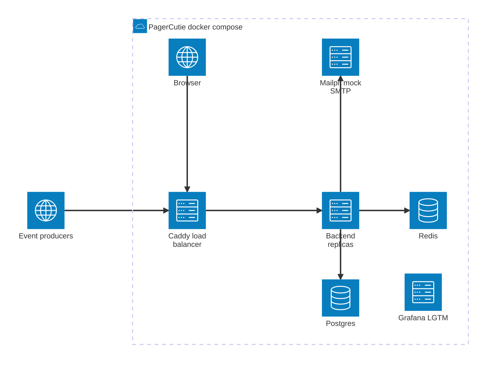

# PagerCutie — Specification

PagerCutie is a notification router and policy evaluator. It ingests events from many sources in arbitrary,
runtime-defined formats, evaluates team-defined rules against them, and delivers alerts to the right people
on the channels they prefer, together with the runbook steps needed to resolve them.

It is multi-user, multi-team and multi-source.

This document describes **how** PagerCutie works. **What** it must do is listed in
[REQUIREMENTS.md](REQUIREMENTS.md); requirement IDs (e.g. `RUL-1`) refer to that file.

---

## 1. Problem and goals

Systems produce errors, warnings and business events (a failed workflow, a breached threshold, a rejected
message). Today these signals are scattered across logs, dashboards and mailboxes, so the right people either
find out too late or receive so many alerts that they stop reading them.

PagerCutie MUST get **the right alert to the right people, on the channel they prefer**, and help them
**resolve it by following the team's runbooks**.

Guiding qualities:

| Quality     | Meaning                                                                    |
|-------------|----------------------------------------------------------------------------|
| Flexibility | Easy to adopt for any team or system.                                      |
| Scalability | A high volume of messages and alerts must not degrade service performance. |
| UX          | Usable by engineers, on-call support, and non-engineers alike.             |

## 2. Glossary

| Term            | Definition                                                                                              |
|-----------------|---------------------------------------------------------------------------------------------------------|
| **Source**      | An origin of events: an HTTP/webhook endpoint, a WebSocket, a tailed log file, a polled API.            |
| **Event**       | A single raw message received from a source.                                                            |
| **Normalised event** | The internal form of an event: ID, source, schema, severity, receive time, JSON payload (§4.2).   |
| **Schema**      | A runtime-defined description of an event's structure, types and value constraints (JSON Schema).      |
| **Rule**        | A condition over event fields plus dedup, routing, presentation and runbook settings.                   |
| **Match**       | The fact that one event satisfied one rule. Input to deduplication.                                     |
| **Fingerprint** | Hash of a rule's dedup fields taken from the event. Matches with the same rule and fingerprint are the same alert. |
| **Alert**       | Created from the first match of a fingerprint. Has a lifecycle: open → acknowledged → resolved.         |
| **Delivery**    | One attempt to notify one recipient about one alert on one channel. Has a status.                       |
| **User**        | A person who can receive alerts.                                                                         |
| **Team**        | A named group of users. Teams own rules.                                                                 |
| **Recipient**   | A user or team that an alert is routed to.                                                               |
| **Channel**     | A delivery medium: Email, SMS, Phone call, UI.                                                           |
| **Runbook**     | Instructions attached to a rule, schema or alert type describing how to resolve an alert.                |
| **Step**        | One item of a runbook: an action, a check or a manual instruction, optionally guarded by `if`.          |
| **Action**      | What a step does: retry workflow, restart service, call webhook, escalate, manual, …                    |
| **Runbook run** | The execution of a runbook for one alert: the state of each step, approvals and results.                |
| **On-call**     | The team member currently responsible for receiving the team's alerts, from a rotation.                  |

## 3. Architecture

### 3.1 Topology



Reading the diagram:

- **Caddy** serves the frontend and balances `/api/*` (management API, SSE feed and ingest webhooks) round-robin
  over the backend replicas (§3.2, ADR-0044).
- **Every backend replica is identical** (ADR-0042): it answers HTTP and runs every background loop. Replicas
  share no memory; state that all of them must see lives in Postgres or Redis.
- **Postgres** is the source of truth: rules, schemas, alerts, deliveries, runbook runs, audit log, sessions.
- **Redis** holds short-lived shared state that keeps the hot path off Postgres: dedup window claims, occurrence
  counters, throttle buckets (§5.2). Losing it costs throughput, never an alert.
- **Every replica** exports OpenTelemetry data to Grafana LGTM (edges not drawn).
- SMS and phone are simulated: the dispatcher writes them to Postgres, and the UI shows them in a "fake phone"
  panel. Email goes to Mailpit, which has its own web inbox.

### 3.2 Backend replicas

The backend is **one codebase, one Docker image and one kind of process**. Every replica runs all of it:

| Part           | Runs as                    | Does                                                                                   | State                                    |
|----------------|----------------------------|----------------------------------------------------------------------------------------|------------------------------------------|
| Management API | HTTP routes                | REST API for the UI, SSE live feed, auth, audit log, action approvals                  | Postgres                                 |
| Ingest         | HTTP and WebSocket routes  | Source adapter → schema matching → rule evaluation → dedup → alert and deliveries (§5.1) | Rules cached in memory; team schemas queried per event; dedup in Redis |
| Dispatcher     | Background loop            | Claims due deliveries, throttles per recipient, sends via channel adapter, retries (§10) | Postgres rows; throttle buckets in Redis |
| Counter flush  | Background loop            | Writes occurrence counters from Redis to the alert rows every 5 s (§9)                  | Redis → Postgres                         |
| Executor       | Background loop            | Runs runbook steps from the Postgres job table, waits for approvals (§11.3)            | Postgres                                 |

- **One scaling knob:** `docker compose up -d --scale backend=N`. HTTP work spreads through Caddy. Background
  loops spread because each claims rows with `FOR UPDATE SKIP LOCKED`, so no two replicas take the same row.
- Each loop is a `Worker` (`core/workers.py`) started and stopped in the FastAPI lifespan. A loop that stops on
  its own sends SIGTERM to its process, so the replica stops answering `/health` and compose restarts it.
- Replicas hold no state of their own, so on SIGTERM a replica only stops accepting connections, finishes
  in-flight requests and stops its loops. Caddy retries refused
  connections on another replica for up to 5 s, so a rolling restart refuses no request.
- `mise run dev` runs one replica with reload against the Postgres and Redis started by `mise run up`.

### 3.3 Technology

| Concern          | Choice                                                                                  |
|------------------|-----------------------------------------------------------------------------------------|
| Backend          | Python 3.14, FastAPI, SQLAlchemy (async) + Alembic, Pydantic                            |
| Load balancer    | Caddy (the frontend's), `dynamic a` upstreams over the compose `backend` service        |
| Shared state     | Redis 8, Python client `redis` (asyncio)                                                |
| Database         | PostgreSQL 18 (`jsonb` for event payloads, rule ASTs and schemas)                       |
| Event validation | JSON Schema 2020-12, validated with `jsonschema-rs` (same Rust engine as the later Rust port) |
| Frontend         | React 19, TanStack Router + Query, Tailwind, shadcn/ui (Base UI), `orval`-generated API client, served by Caddy |
| Observability    | OpenTelemetry → `grafana/otel-lgtm` (Grafana, Prometheus, Tempo, Loki, Pyroscope)               |
| Email mock       | Mailpit                                                                                 |
| Later            | Hot paths ported to Rust, first the evaluator as a PyO3 module                          |

## 4. Contracts

All contracts live in `contract/`. Generated code is never edited by hand. CI regenerates every artifact and
fails if the committed file differs (`mise run contract:check`).

| Contract             | Between                              | Format                    | File                                  |
|----------------------|--------------------------------------|---------------------------|---------------------------------------|
| Rule AST, runbooks   | frontend builder ↔ API ↔ evaluator / executor | JSON Schema 2020-12, generated from Pydantic | `contract/rule.schema.json`, `contract/runbook.schema.json` |
| Evaluator test cases | Python evaluator ↔ Rust evaluator    | JSON fixtures, hand-written | `contract/rule-tests/*.json`        |
| Fingerprint vectors  | Python dedup ↔ Rust dedup            | JSON fixtures, hand-written | `contract/fingerprint-tests.json`   |
| Template cases       | Python templates ↔ Rust templates    | JSON fixtures, hand-written | `contract/template-tests.json`      |
| Management API       | frontend ↔ API                       | OpenAPI 3.1               | `contract/openapi.json`               |
| User event schemas   | users → ingest                       | JSON Schema, **stored as data** in Postgres | none (runtime data) |

### 4.1 Compatibility rules

- Changes MUST be **additive**: add fields, never rename, retype or reuse them. Consumers ignore unknown fields.
  Pre-release exceptions: `schema_resolution` was removed from the source DTOs (ADR-0065); audit `action` and
  `entity_type` became enums (ADR-0079).
- During a rolling update old and new replicas answer side by side behind Caddy, so a client MUST tolerate a new
  response field being absent until the rollout ends.

### 4.2 Normalised event

Every source adapter turns its input into one frozen Pydantic model in `pipeline/messages.py`, the input of rule
evaluation and dedup (§5.5):

```python
class Event(Message):
    event_id: uuid.UUID               # UUIDv7, assigned by ingest
    source: str                       # source slug, e.g. "payments-webhook"
    source_id: uuid.UUID
    team_id: uuid.UUID                # the source's owning team
    schema_id: uuid.UUID              # resolved by ingest (§7)
    schema_name: str                  # name of that schema; rules and templates see it as `schema`
    severity: Severity                # normalised (§8.1)
    received_at: UtcDatetime          # ingest time; basis for end-to-end latency
    payload: dict[str, JsonValue]     # event body as JSON, whatever the original wire format was
```

- `payload` is always **JSON**. A source that receives protobuf (or anything else) decodes it to JSON in its
  adapter, so evaluation and dedup deal with one format only.
- The event exists only inside the ingest request; it crosses no process boundary. An alert keeps its first
  event's `payload` for templating (DOMAIN.md §3).

### 4.3 Rule AST: `contract/rule.schema.json`

**Source of truth: Pydantic models in the backend.** Each node type is one model with a `Literal` tag, and
all of them form a **discriminated union** on the key `op`. From that single definition:

- `contract/rule.schema.json` (the whole rule document, `RuleCreate`, with `Condition` in its `$defs`) and
  `contract/runbook.schema.json` (the structured YAML runbook) are exported by `mise run contract`, for the
  Rust port (types generated with `typify`) and for tools;
- FastAPI includes the models in `contract/openapi.json`, so `orval` generates the TypeScript union types and
  zod validators for the visual builder.

The API validates every rule before saving it, so the evaluator never sees an invalid AST.

```python
type Scalar = str | int | float | bool | None
type FieldPath = Annotated[str, Field(pattern=r"^[A-Za-z_]\w*(\.\w+)*$")]

class And(BaseModel):
    op: Literal["and"]
    args: list[Condition] = Field(min_length=1)

class Or(BaseModel):
    op: Literal["or"]
    args: list[Condition] = Field(min_length=1)

class Not(BaseModel):
    op: Literal["not"]
    arg: Condition

class Compare(BaseModel):
    op: Literal["eq", "ne", "gt", "gte", "lt", "lte"]
    field: FieldPath
    value: Scalar

class In(BaseModel):
    op: Literal["in", "not_in"]
    field: FieldPath
    value: list[Scalar] = Field(min_length=1)

class Contains(BaseModel):
    op: Literal["contains"]
    field: FieldPath
    value: Scalar

class Glob(BaseModel):
    op: Literal["glob"]          # "pricing-engine-*", "trade.rejected.*"
    field: FieldPath
    value: str

class Exists(BaseModel):
    op: Literal["exists"]
    field: FieldPath

type Condition = Annotated[
    And | Or | Not | Compare | In | Contains | Glob | Exists,
    Field(discriminator="op"),
]
```

**Fields** are dot paths into the normalised event `{"source": …, "schema": …, "schema_id": …,
"severity": …, "payload": { … }}`, e.g. `source`, `payload.amount`, `payload.error.code`. The root is named
`payload` to match the brief's templates (`{{payload.currency}}`). These five are the only root names. `schema` is
the event schema's name and survives version bumps; `schema_id` is the UUID string of the one version that matched.
Both are `null` when unknown. A bare `schema` path reads the root, so a payload key named `schema` needs
`payload.schema` (ADR-0089). A segment of ASCII digits indexes into an array (`payload.items.0.sku`) and is an ordinary key on an object
(ADR-0060).

A condition nests at most 32 levels deep (`MAX_DEPTH` in `rules/ast.py`; a predicate counts 1). The rule DTOs
reject deeper input with `422`, so evaluation cannot hit Python's recursion limit.

**Example:** the brief's `amount > 1,000,000` or `error.code in [TIMEOUT, REJECTED]`, critical only:

```json
{
  "op": "and",
  "args": [
    { "op": "eq", "field": "severity", "value": "critical" },
    { "op": "or", "args": [
      { "op": "gt", "field": "payload.amount", "value": 1000000 },
      { "op": "in", "field": "payload.error.code", "value": ["TIMEOUT", "REJECTED"] }
    ]}
  ]
}
```

A full **rule** wraps the condition with its other parts (§8). Example: the brief's Team Settlements rule. IDs are
shown as readable names for clarity; in the API they are UUIDs (DOMAIN.md §1), and the owner is
`{"type": "team", "team_id": …}`.

```json
{
  "id": "r-settlement-failed",
  "team_id": "settlements",
  "name": "Order settlement failed in prod",
  "enabled": true,
  "condition": { "op": "and", "args": [
    { "op": "eq", "field": "payload.type", "value": "WORKFLOW_FAILED" },
    { "op": "eq", "field": "payload.workflowName", "value": "order-settlement" },
    { "op": "eq", "field": "payload.environment", "value": "prod" }
  ]},
  "dedup": { "fields": ["payload.workflowId"], "window_s": 300 },
  "routing": { "recipients": [{ "type": "on_call", "team_id": "settlements" }], "channels": ["phone", "sms"] },
  "presentation": {
    "title": "Settlement {{payload.workflowId}} failed at {{payload.step}}",
    "body": "{{payload.error.message}}",
    "fields": ["payload.step", "payload.error.message"],
    "severity": "critical",
    "colour": "red"
  },
  "runbook_id": "settlement-timeout"
}
```

`routing.channels: null` means "use each recipient's channel preferences for this severity" (`DEL-2`).

### 4.4 Adding a variant: merge checks

New conditions (§4.3), runbook actions (§11.2) and channels are added **in Python only**: one new model in
the union, plus its handler. The type checkers then block the merge until every consumer handles it:

| Where                | Mechanism                                                         | What fails                       |
|----------------------|-------------------------------------------------------------------|----------------------------------|
| Generated files      | `contract:check` regenerates and runs `git diff --exit-code`      | The contract was not regenerated |
| Python consumers     | `match` over the union ending in `case _: assert_never(x)`       | `ty check`: variant not handled  |
| Frontend             | Handler maps declared with `satisfies Record<Condition["op"], …>` | `tsc`: missing key               |
| Evaluator test cases | A test asserting every `op` has ≥1 case in `contract/rule-tests/` | pytest                           |
| Rust (later)         | `match` on the generated enum                                     | The compiler                     |

```python
def evaluate(c: Condition, event: Event) -> bool:
    match c:
        case And(args=args): return all(evaluate(a, event) for a in args)
        case Or(args=args):  return any(evaluate(a, event) for a in args)
        case Not(arg=arg):   return not evaluate(arg, event)
        case Compare():      return compare(c, event)
        case In():           return member(c, event)
        case Contains():     return contains(c, event)
        case Glob():         return glob(c, event)
        case Exists():       return lookup(event, c.field) is not MISSING
        case _:              assert_never(c)
```

```ts
const editors = {
  and: GroupEditor, or: GroupEditor, not: NotEditor,
  eq: CompareEditor, ne: CompareEditor, gt: CompareEditor, gte: CompareEditor, lt: CompareEditor, lte: CompareEditor,
  in: InEditor, not_in: InEditor, contains: CompareEditor, glob: GlobEditor, exists: ExistsEditor,
} satisfies Record<Condition["op"], ConditionEditor>;
```

`ty` reports an unhandled variant as `type-assertion-failure` on the `assert_never` call (checked with ty 0.0.107
against `Condition`), so `mise run lint:ty` is enough; no second checker is needed.

### 4.5 Management API

- FastAPI generates the OpenAPI document. `mise run contract` exports it to `contract/openapi.json`.
- The frontend's API client, TypeScript types and zod schemas are generated from it with `orval`.
- Errors use one JSON error format across all endpoints.

## 5. Processing and shared state

### 5.1 Ingest request

*Satisfies `NFR-2`, `DEL-5`.*

`POST /ingest/{source_slug}`, and each message on the source's WebSocket, is processed to the end inside the
request, on whichever replica Caddy picked:

1. Authenticate the source token, decode the input to JSON (§6), match it against the team's schemas (§7). Invalid
   input answers `422` with the validation errors.
2. Build the normalised `Event` (§4.2).
3. Evaluate the cached enabled rules for that schema (§8).
4. For each match, compute the fingerprint and deduplicate (§5.2, §9).
5. Answer `202 {"event_id": …, "matches": n}`.

- **Accepted means committed.** The `202` is sent after step 4 has committed every new or updated alert, its
  `pending` deliveries and its runbook run. If a replica dies before answering, the producer sees a connection
  error and retries. The retry is a new event that dedup folds into the same alert, so it can count one
  occurrence twice; producers send no idempotency key.
- **No buffer in front of evaluation.** Ingest throughput is replicas × per-replica rate. Postgres writes grow
  with alerts, not events, because dedup answers repeats from Redis. Under overload latency rises; a replica
  whose database pool times out answers `503`, and producers retry with backoff. The scaling lever is more
  replicas, then Postgres.

### 5.2 What lives where

| State                                         | Store                                                  | Why                                                                 |
|-----------------------------------------------|--------------------------------------------------------|---------------------------------------------------------------------|
| Rules, schemas, alerts, deliveries, runbook runs, audit log, sessions | Postgres                       | Source of truth, transactional                                      |
| Compiled rules, source catalog                | Memory of each replica, reloaded on `NOTIFY` (§5.3)    | Evaluated for every event; no network round trip                    |
| Team schemas matched by ingest                | Postgres, one query per event (§7, ADR-0065)           | An event always matches against the committed schemas               |
| Dedup window claim `dedup:{rule_id}:{fingerprint}` | Redis `SET pending NX GET EX window_s`            | One atomic round trip decides "first in window" across all replicas |
| Occurrence counter `count:{alert_id}`         | Redis hash: `n` (count), `seen` (newest `received_at`); flushed every 5 s (§9) | 500 repeats cost 500 Redis round trips and about two Postgres writes |
| Throttle bucket `throttle:{recipient_id}`     | Redis, token bucket in one Lua script                  | One per-recipient limit across every replica's dispatcher           |

**Redis is an accelerator; Postgres decides.** A partial unique index on `fingerprint` of
non-resolved alerts makes the alert upsert idempotent, whatever Redis says. The fingerprint hashes the rule ID, so
it is unique across rules. The claim only decides whether a match goes to Postgres:

- **Claim won** (`SET NX` stored `pending` and returned nothing): upsert the alert, insert its deliveries and
  runbook run, commit, then `SET … <alert_id> XX KEEPTTL`. If the transaction fails, `DEL` the key and answer `500`.
- **Claim lost, key holds an alert ID:** count the occurrence in the alert's Redis counter only; the alert is
  already committed.
- **Claim lost, key still `pending`:** the winner has not committed yet, or failed. Take the Postgres upsert
  path, so a failed winner drops no event.
- **Redis unreachable** (no answer within 0.5 s, `core/redis.py`): every match takes the Postgres upsert path and
  throttling lets every delivery through. Alerts stay correct; Postgres writes grow with events until Redis is back.
- **Redis restarted empty** (compose runs it without persistence): every window claim is gone, so the next match
  of each active fingerprint takes the Postgres path once and claims a new window.
- **Alert resolved** (by a user or `RUN-5`): after the resolve commits, `core.redis.delete_dedup_window` deletes
  the window, so the next match opens a new alert instead of counting on the resolved one (ADR-0077). With Redis
  unreachable the window expires on its own within `window_s`.

**The alert row decides the outcome** of every Postgres-path match, in one `INSERT … ON CONFLICT DO UPDATE`
(ADR-0076):

- No unresolved alert with the fingerprint: insert one, **`Opened`**.
- An unresolved alert whose `notified_at` is at least `window_s` before the event's `received_at`: count the
  occurrence, increment `notifications`, set `notified_at`, **`Renotified`**. Acknowledged alerts renotify too.
- Any other unresolved alert: count the occurrence, **`Repeated`**.

Two matches racing on one fingerprint meet on one row: the second upsert waits for the first to commit, then finds
a fresh `notified_at` and repeats, so a recipient is never notified twice for one window. `RETURNING old.*`
(Postgres 18) tells an insert from an update. The upsert sends `NOTIFY alert_changed`, and matches that took the
Postgres path without a won claim count in `dedup_fallback_total{reason}` (`pending` or `unavailable`).

A Held match runs one Lua script that increments `n`, keeps the newer `seen` and adds the alert ID to the set
`count:dirty`. Counters are keyed by alert, not fingerprint, so a count never lands on a newer alert of the same
fingerprint.

The **counter flush** (`pipeline/dedup/worker.py`, ADR-0078) runs on every replica every 5 s, and once more when
the replica stops:

1. One Lua script pops up to 500 IDs from `count:dirty` and reads and deletes their counters. `SPOP` gives each
   counter to one replica, and an increment lands either in this batch or in a fresh counter.
2. One `UPDATE … FROM (VALUES …)` adds `n` to `occurrences` and moves `last_seen_at` forward to `seen`, then
   `NOTIFY alert_changed`. Batches repeat until `count:dirty` is empty.
3. If the transaction fails, the counters go back to Redis for the next flush, so a database outage delays counts
   instead of losing them.

A replica that dies between steps 1 and 2 loses that batch: `occurrences` is approximate, alert creation is exact.

### 5.3 Signals between replicas

Postgres `LISTEN/NOTIFY` carries every cross-replica signal: `rules_changed` and `sources_changed` (cache
reload), `access_changed` (a membership or a global role changed, or a user was soft-deleted, so personal rules' source
scopes reload, §8), `alert_changed` (SSE feed; its payload is an `AlertChanged` JSON object with the alert ID and `alert.created` or
`alert.updated`, sent by every alert write, by the UI channel adapter once it has recorded the delivery, and whenever
the alert's runbook run starts or a step changes by a person's decision or an executor outcome, ADR-0097), `deliveries_pending` (wakes the dispatchers), `steps_pending`
(wakes the executors). Postgres sends a
notification only when its transaction commits, so no listener acts on a change that rolled back; Redis pub/sub
would need the publish to follow the commit by hand. Each replica holds one dedicated listening connection
(`core/listen.py`), taken from the engine's pool and invalidated on exit, which maps each channel to its handler.
Every handler runs after each (re)connect. A `SELECT 1` heartbeat after 10 s without notifications finds a half-open
connection. A lost connection or a failed handler calls `on_lost` and reconnects with backoff (ADR-0063).

### 5.4 Delivery semantics

**At-least-once** end to end, made safe by idempotent writes:

1. Alert upserts (partial unique index on the fingerprint) and delivery inserts (unique deterministic
   `delivery_id`) can repeat without creating duplicates. The delivery ID is derived from the alert, recipient,
   channel and the alert's notification round (`alerts.notifications`), so a renotification gets new IDs.
2. The dispatcher marks a delivery `sent` only after the channel adapter returned. A replica that dies in between
   leaves a lease that expires, and another replica sends the delivery again (§10).

### 5.5 Stage boundaries

*ADR-0045.* Each processing step is a package under `backend/src/pagercutie/pipeline/` with its entrypoints in
`stage.py` and, for background work, its loop in `worker.py`:

| Package      | Entrypoints                                         | Input → output                                        |
|--------------|-----------------------------------------------------|-------------------------------------------------------|
| `ingest`     | `load_catalog`, `normalise`                         | `RawEvent` → `Event`, or `EventRejected` (`422`)      |
| `evaluation` | `load_rule_set`, `evaluate`, `fingerprint`          | `Event` + `RuleSet` → `list[Match]`                   |
| `dedup`      | `claim`, `record`, `repeat`, `confirm`, `release`; loop `flush_counters` | `Match` → `DedupOutcome = Opened \| Renotified \| Repeated` |
| `routing`    | `route`                                             | `Opened \| Renotified` → `pending` deliveries         |
| `dispatch`   | `claim_due`, `send`, `complete`; loop `run`         | `DeliveryJob` → `Sent \| SendFailed \| Throttled`     |
| `executor`   | `start_run`, `claim_due_steps`, `run_step(job, integrations)`, `complete_step(session, job, outcome, now)`; loop `executor_loop` | `Opened` → runbook run; `StepJob` → `StepOutcome` |

- **Messages** between stages are frozen Pydantic models in `pipeline/messages.py` (`RawEvent`, `Event`, `Match`,
  the `DedupOutcome` union, `IngestResult`). `Match` carries the rule as evaluated (`RuleRead`), so routing and the
  executor read no rule rows.
- **`pipeline/orchestrator.py`** (`process_event`) is the only module that calls the in-request stages. It runs
  `normalise` → `evaluate` → `claim` per match → one transaction with `record`, `route` and `start_run` per
  outcome → `confirm` after the commit, or `release` for every claim if anything fails. A `Held` claim is counted
  by `repeat` in Redis and opens no transaction. Each `match` over a union ends in `assert_never`.
- **After the commit** the stages meet only through tables: `dispatch` claims `deliveries` rows, `executor` claims
  `step_runs` rows. Repeat occurrences reach runbook guards through `alerts.occurrences` (ADR-0020).
- **External dependencies are Protocols** in the stage that needs them: `dedup.WindowStore` (Redis
  implementation in `dedup/windows.py`) and `dispatch.Throttle` (Redis), `dispatch.ChannelAdapter` (one per channel, `DEL-4`). Stage tests use fakes.
- **Boundaries are checked** by import-linter (`mise run lint:imports`, contracts in `backend/pyproject.toml`):
  stages do not import each other or the orchestrator, and entity packages do not import `pipeline`. Stages call
  entity models and services directly.
- Entrypoints not built yet raise `NotImplementedYet`; the loops log and wait, so a replica keeps running.

## 6. Sources

*Satisfies `ING-1`, `ING-2`.*

- Every source type implements one **source adapter** (`pipeline/adapters.py`): receive raw input, return a
  `RawEvent` (source slug, adapter type, token, content type, body) and pass it to `orchestrator.process_event`.
  Adding a source type means writing one adapter, adding it to `ADAPTERS` and its route to
  `sources.service.INGEST_PATHS`, which also renders `SourceRead.ingest_url` (ADR-0061, ADR-0064). The adapters live outside the stage packages because they call
  the orchestrator.
- Adding a new **instance** of an existing type (another webhook path) is configuration only: `POST /sources`,
  then `POST /sources/{id}/token`. The source accepts events once it has a token (`SourceRead.has_token`).
- Initial adapters: **HTTP webhook** (`POST /ingest/{slug}`, one event per body) and **WebSocket**
  (`/ingest/{slug}/ws`, one event per frame). Planned: **protobuf** (over HTTP, possibly gRPC); until its adapter
  exists, creating a `protobuf` source answers 422.
- Producers authenticate with `Authorization: Bearer <token>`; only its SHA-256 is stored. Unknown, disabled or
  tokenless slug, or a source of another type, `404`; bad token `401`. The WebSocket handshake is denied with the
  same status; a token rotated or a source disabled mid-connection closes it with `1008`, a dropped catalog with
  `1013`.
- `ingest.normalise` decodes the body as a JSON object, resolves `schema_id` by matching the payload against the
  owning team's schemas (§7), and maps severity (`severity.field` value through
  `severity.values`, else `severity.default`). Failures raise `EventRejected` (`422`, §7).
- Ingest replies to a webhook only after the resulting alerts and deliveries are committed (§5.1), so an accepted
  event is never lost. The WebSocket answers each frame in order with the `202` body, or
  `{"status", "detail"}` with the status the webhook would answer.
- Each replica keeps the `SourceCatalog` (enabled sources with a token) in memory and reloads it on
  `NOTIFY sources_changed`, sent by every source write; ingest answers `503` until the first load (ADR-0062).
  Losing the listening connection drops the catalog and the rule set, so ingest fails closed (`503`) until the
  reconnect reloads them (ADR-0063, ADR-0093). A source row whose stored config no longer validates is logged and left out of the catalog.

## 7. Events and schemas

*Satisfies `SCH-1` – `SCH-3`.*

- Event schemas are **JSON Schema 2020-12 documents stored in Postgres** (`event_schemas`), owned by a team and
  added at runtime. Each row is one immutable version of a `name`; a change is a new row with a higher `version`
  (`POST /event-schemas`, still `501`). There is no delete, so rules reference versions by ID. JSON Schema covers `SCH-3`: sub-schemas (`$defs` / `$ref`), types (primitive, array, object) and
  type-dependent constraints (`maxLength`, `minimum`, `minItems`, …).
- Ingest picks an event's schema by matching; sources carry no schema config (ADR-0065). For every event it queries
  the latest version of each schema the source's team owns (`event_schemas.service.latest_team_schemas`,
  `DISTINCT ON (name) … ORDER BY name, version DESC`) in a session of its own, and validates the payload against each one with `jsonschema-rs`, offline
  (a remote `$ref` is never fetched). The most specific valid schema wins: most top-level `required` keys, then most
  top-level `properties`. No valid schema, or a tie between the most specific ones, rejects the event with
  `SCHEMA_UNRESOLVED`. A stored schema that no longer compiles is logged and never matches. A new schema version
  takes effect on the next event after its commit; no cache or `NOTIFY` is involved.
- Events that fail matching are answered with `422` (an error frame on WebSocket) and increment
  `events_rejected_total{reason}`. The producer learns of every rejection, so there is no dead-letter store.
- Ingest does not store raw events. Postgres keeps the first event's payload of each alert; events that match no
  rule are counted and discarded.

## 8. Rules

*Satisfies `RUL-1` – `RUL-5`.*

| Part             | Contents                                                                    |
|------------------|-----------------------------------------------------------------------------|
| **Condition**    | AST of AND / OR / NOT groups and predicates (§4.3).                         |
| **Dedup**        | Fields forming the fingerprint, window length (§9).                         |
| **Routing**      | Recipients; channels, or `null` to use the recipients' preferences.        |
| **Presentation** | Title and body templates, included fields, severity, UI colour (required).  |
| **Runbook**      | Optional runbook attachment (§11).                                          |

- Rules are edited in the **visual builder**, which produces the AST directly. A textual syntax MAY be added
  later on top of the same AST.
- Rules are stored in Postgres and changed through the API (`RUL-5`), which checks owners and references before
  writing (ADR-0092) and sends `NOTIFY rules_changed` with every write. Every replica caches all enabled rules
  in memory, compiled once to closures, and reloads on `NOTIFY rules_changed` and `access_changed`; ingest answers
  `503` until the first load (ADR-0093). No restart is needed.
- Deleting a rule sets `deleted_at`; its alerts keep referencing it and the rule set leaves it out (ADR-0091).

### 8.1 Evaluator semantics

The evaluator is a pure function `(rule, event) → bool`. It is **total**: it never raises on any input. It lives
in `rules/evaluator.py`, so the pipeline and `POST /rules/test` share it; `pipeline/evaluation` compiles each rule
with it once per reload (ADR-0060).

- A predicate on a **missing field** is `false`, except `exists`. `exists` is `true` for a present `null`.
- **Equality is JSON equality:** numbers compare by value (`1` equals `1.0`), a bool is never a number (`true`
  does not equal `1`), a number never equals a string (`5` does not equal `"5"`), and `null` equals only `null`.
  `eq`, `ne`, `in` and `not_in` on an object or array field are `false`.
- `ne` and `not_in` are the negations of `eq` and `in` for a present scalar field, so a type mismatch makes them
  `true` (`ne "5"` against `5`).
- A predicate with a **type mismatch** in an ordering (e.g. `gt` on a string field against a number) is `false`.
- `not` negates the result above, so `not(eq)` is `true` for a missing field. This is intended.
- `contains`: substring for a string field and a string value, membership (JSON equality) for an array field,
  `false` otherwise.
- `glob`: whole-string match on strings, `false` otherwise. `*` matches any run of code points, dots included,
  and `?` exactly one. It is case-sensitive and has no `[...]` classes: brackets match themselves.
- `gt`/`gte`/`lt`/`lte` compare numbers with numbers and strings with strings by code point (ISO timestamps in one
  format and time zone sort correctly).
- **`severity` is ordered:** ingest normalises it to `debug < info < warn < error < critical` (mapping
  per source, e.g. `WARNING → warn`), so "WARN or above" is `{"op": "gte", "field": "severity",
  "value": "warn"}`.

The cases in `contract/rule-tests/*.json` MUST pass in every evaluator implementation, Python and Rust. Each file
is an array of `{name, condition, event: {source, schema, schema_id, severity, payload}, expected}`; `event.schema` is
optional and means unknown when absent. A test fails when an
`op` of the `Condition` union has no case.

A **personal rule** only matches events whose source belongs to one of its owner's teams, in any role; an admin's
personal rule matches every source, and a soft-deleted user's personal rule matches none (DOMAIN.md §4). The rule set stores that scope per rule and reloads on
`access_changed` (§5.3).

## 9. Noise reduction

*Satisfies `NOI-1`, `NOI-2`.*

- **Fingerprint:** hex SHA-256 of the ASCII bytes of the canonical JSON array `[rule_id, value₁, …]`, one value
  per `rule.dedup.fields` entry in order. Canonical means sorted object keys, no whitespace and non-ASCII escaped
  as `\uXXXX`; a missing field counts as `null`, and numbers keep their JSON form (`1` and `1.0` differ). An
  empty field list means one alert per rule per window. `contract/fingerprint-tests.json` pins the canonical
  string and the hash for each case (ADR-0060).
- **Grouping** uses the same mechanism: the brief's "group pricing log lines into one alert per instrument
  every 5 minutes" is `"dedup": {"fields": ["payload.instrument"], "window_s": 300}`.
- **Deduplication** (ingest, §5.2): the first match of a fingerprint within `window_s` claims the window in Redis,
  upserts an alert in Postgres and creates the deliveries. Later matches only increment a Redis counter, which
  the counter flush loop adds to the alert row every 5 s. 500 identical errors cost about two Postgres writes,
  not 500.
- A partial unique index on the fingerprint of **non-resolved** alerts makes the upsert idempotent, so two
  replicas racing on one fingerprint, or a Redis outage, never create a second alert. An open alert is renotified
  once its last notification is `window_s` old (§5.2).
- **Throttling** (dispatcher): a per-recipient token bucket in Redis, shared by every replica's dispatcher, for
  email, SMS and phone (the UI channel is never throttled). Throttled deliveries are grouped into a digest
  delivery instead of being dropped (§10, ADR-0081, ADR-0083).

## 10. Delivery

*Satisfies `DEL-1` – `DEL-6`.*

- Every channel implements one **channel adapter** interface. Replacing a simulated provider with a real one
  touches only that adapter (`DEL-4`).

  | Channel | Adapter for the demo                                    |
  |---------|---------------------------------------------------------|
  | Email   | SMTP to Mailpit                                         |
  | SMS     | Simulated: row in Postgres, shown in the UI notifications drawer |
  | Phone   | Simulated: row in Postgres, shown in the UI notifications drawer |
  | UI      | Row in Postgres + `NOTIFY`, pushed to the browser over SSE |

- **Recipients** are users, teams, or `on_call` of a team. The on-call person comes from a simple weekly
  rotation table (`DEL-3`), resolved when ingest creates the deliveries.
- **Channel preferences** map severity to channels and MAY have a time window with a fallback (`DEL-3`), e.g.
  Anna: `critical → sms` between 08:00 and 20:00 in her time zone, otherwise `email`.
- Ingest inserts each delivery as `pending` (idempotent by `delivery_id`) in the alert's transaction (§5.1).
- **Dispatching:** every replica's dispatcher loop claims due deliveries (`pending` or `failed` with no `retry_at`
  or one that passed, no live `lease_until`) in batches with `SELECT … FOR UPDATE SKIP LOCKED`, sets `lease_until = now() + 30 s` and commits.
  It sends outside the transaction, then marks each delivery `sent` or `failed` (`DEL-6`). The loop wakes on
  `NOTIFY deliveries_pending` and polls once a second for retries, so a new delivery does not wait for a poll
  (`NFR-3`).
- **Claim size:** a batch claims at most `min(delivery_batch_size, 16)` rows, and the loop sends all of them at
  once. No claimed row waits for a send slot while its lease runs, so a slow channel cannot let a lease expire and
  have another replica send the delivery twice (ADR-0084). A full batch makes the loop claim again at once.
- **Retries:** a failed delivery gets `retry_at = now + min(2^attempts, 300) s` and is claimed again by the same loop,
  without a limit on attempts, so a channel that is down for a long time never blocks other deliveries and no
  delivery is lost (`DEL-5`). `complete` writes only while `lease_until` still holds the value the claim set, so a
  replica whose lease expired cannot overwrite the replica that took over.
- **Permanent failures:** a user without a phone number (SMS, phone), a deleted or missing user and an SMTP 5xx
  answer make the delivery `failed` with `retry_at` null; it is never claimed again (ADR-0082).
- **Throttling and digests:** email, SMS and phone deliveries take a token from the user's bucket (capacity 5,
  one more every 12 s; `throttle_capacity`, `throttle_refill_seconds`) before the adapter runs. With an empty
  bucket the delivery stays `pending` and, with other undelivered deliveries of the same user and channel, joins a
  digest delivery whose message lists up to 10 first lines. The members stay `pending` and are skipped by claims;
  they become `sent` with the digest, or `failed` if it fails permanently (ADR-0081, ADR-0083). When Redis is
  unreachable the delivery is sent without throttling.
- **Event time:** `deliveries.received_at` holds the `received_at` of the event that caused the delivery; a digest
  takes its oldest member's. It starts the end-to-end latency (§13).

## 11. Runbooks and actions

*Satisfies `RUN-1` – `RUN-8`.*

Judges will bring runbook formats we have not seen (`RUN-8`). Design rule: **every runbook always displays
correctly, and the parts we understand become executable steps.**

### 11.1 One model, several input formats

```python
class Runbook(BaseModel):
    id: str
    title: str
    attach: Condition                 # when this runbook applies (§4.3)
    format: Literal["structured", "markdown", "text", "link"]
    original: str                     # raw input, always kept and viewable
    steps: list[Step]
```

| Input            | Parsing                                                               | Result                                   |
|------------------|-----------------------------------------------------------------------|------------------------------------------|
| Structured YAML  | Validated directly against the Pydantic `Runbook` model               | Executable steps                         |
| Markdown         | Numbered or bulleted items → `manual` steps; links detected           | A checklist, ticked off by humans        |
| Wiki / link      | Stored as a link                                                      | One `manual` step: "open the runbook"    |
| Free text, unknown | Stored as-is                                                        | One `manual` step showing the text       |

- **Attaching (`RUN-1`, ADR-0089).** A run starts from the rule's linked runbook when the rule has one. Otherwise
  it starts from the oldest (`created_at`, then `id`) of the alert's team's runbooks whose `attach` matches the
  alert's first event, evaluated like a rule condition (§4.3). Runbooks of other teams are never candidates, and
  a personal rule, which has no team, only uses its link.
- The YAML's `matches:` block is shorthand for an `and` of `eq` conditions on payload fields, converted to
  `attach` (`"error.code": TIMEOUT` → `payload.error.code`). The runbook's `slug` wins over the YAML's `runbook:`.
- Parsing is pure (`runbooks/parsing/`) and shared by `POST /runbooks/parse`, create and update. Markdown links
  stay in the step text; text longer than one step allows (2000 characters) is split into several `manual` steps.
  Details and fallbacks: ADR-0069.
- **(optional)** An LLM proposes a structured version of a Markdown or free-text runbook. A human reviews it
  in the UI before it is saved. This also serves `UI-4` and `RUN-7`. If built, `SUB-3` requires describing
  how security and privacy were handled.

### 11.2 Steps and actions

Steps are a discriminated union on the key `action`, which is the key the brief's YAML already uses. Adding
an action follows §4.4: one model and one handler.

```python
class StepBase(BaseModel):
    check: str | None = None                                   # question shown to humans
    if_: str | StepGuard | None = Field(None, alias="if")      # guard, see §11.4
    approval: Literal["none", "required"] | None = None        # None → the action's default

class HttpGet(StepBase):       action: Literal["http_get"];       url: Templated[str]
class RetryWorkflow(StepBase): action: Literal["retry_workflow"]; workflow_id: Templated[str] = Field(alias="workflowId")
class RestartService(StepBase): action: Literal["restart_service"]; service: Templated[str]
class CallWebhook(StepBase):   action: Literal["call_webhook"];   url: Templated[str]
class OpenTicket(StepBase):    action: Literal["open_ticket"];    title: Templated[str]
class Escalate(StepBase):      action: Literal["escalate"];       team: str
class Wait(StepBase):          action: Literal["wait"];           seconds: int
class Manual(StepBase):        action: Literal["manual"];         text: str

type Step = Annotated[
    HttpGet | RetryWorkflow | RestartService | CallWebhook | OpenTicket | Escalate | Wait | Manual,
    Field(discriminator="action"),
]
```

- **Risk defaults:** every action type has a default approval. `http_get`, `retry_workflow`, `open_ticket`, `wait`
  and `manual` default to `none`; `restart_service`, `call_webhook` and `escalate` default to `required`. A runbook
  MAY make a step stricter than its default, never looser (`RUN-4`), so `approval: none` on a risky action has no
  effect ([ADR-0088](decisions/0088-executor-gates-taken-from-pr-7.md)). The frontend copies this table until the
  contract exposes it (ADR-0071).
- **Templates** (`Template` in `core/schemas.py`; rule titles and bodies use the same type) are rendered from the
  event: by the executor when a step runs, by dedup when an alert opens. The engine is ours (`core/templates.py`,
  ADR-0075):
  - `{{ path }}` is the only syntax for now. The path follows `FieldPath` (all-digit segments index arrays) and
    resolves like a rule condition's field (§4.3). A path whose first segment is not `source`, `schema`,
    `schema_id`, `severity` or `payload` is read under `payload`, so the brief's `{{workflowId}}` is `{{payload.workflowId}}`.
  - Anything else between `{{` and `}}`, including `|` and `(`, is a syntax error, reserved for filters and
    functions. An unclosed `{{` is an error; a lone `}}` is text. The API rejects an invalid template with `422`.
  - Rendering never raises: strings as they are, null and missing fields as empty, other values as compact JSON
    with sorted keys. `contract/template-tests.json` pins this for every implementation.
- `retry_workflow`, `restart_service` and `open_ticket` call webhooks on a small mock service in the demo.
- **Action integrations:** `run_step` acts through `Integrations`. `http_get` and `call_webhook` use `HttpClient`
  (`httpx`, 5 s timeout; a transport failure or a non-2xx status fails the step); `call_webhook` sends the run's event
  view as the JSON body for `POST` and `PUT` and no body for `GET`. `retry_workflow`, `restart_service` and
  `open_ticket` use `OpsService`, simulated in-process until the mock service exists
  ([ADR-0013](decisions/0013-simulated-channels-behind-a-channel-adapter-interface.md) precedent). `wait` schedules
  the next claim instead of sleeping.

### 11.3 Runbook runs

When an alert fires, a **runbook run** is created: a state machine stored in Postgres, one row per step.

```
step:  pending → (awaiting_approval | awaiting_answer | awaiting_manual →) running → succeeded | failed | skipped
```

`awaiting_answer` is an unparsed guard waiting for a yes / no, `awaiting_manual` a `manual` step waiting to be ticked
off. Decisions and permissions: [DOMAIN.md §6](DOMAIN.md#6-lifecycles).

- Steps are executed by the **executor**, a background loop in every replica. It claims up to 20 step runs per
  pass whose `run_at` has passed, with `SELECT … FOR UPDATE SKIP LOCKED`, and runs them concurrently outside the
  transaction. Resolving an alert closes its run in the resolve transaction: unfinished steps become `skipped`
  (audited with the resolving user) and every `run_at` is set to null (ADR-0095). The claim still parks steps of
  resolved alerts that a resolve missed. Claiming moves `run_at` to `now + 30 s` (the lease) and leaves `status`, `guard_answered` and `approved` alone, so a
  replica that dies mid-step lets the lease expire and another claims the step again (ADR-0008). Each outcome is
  written in its own transaction by an `UPDATE` conditional on the lease, `status`, `guard_answered` and `approved` the
  step had when claimed; a late outcome (the lease expired and another replica claimed the step) or one overtaken by
  a person's decision (which changes the status or a flag, or sets `run_at`) is dropped (`executor.step_outcome_stale`), and the step is checked again by the next claim. The loop
  wakes on `NOTIFY steps_pending` and polls once a second for delays that ended and leases that expired.
- A finished step (`succeeded`, `failed`, `skipped`) sets `run_at = now` on the next pending step of the run, or
  audits `runbook_run.finished` when no step is unfinished. Steps therefore run in index order, and a guarded step
  is checked again whenever the run reaches it (§11.4). A `wait` step is `running` until its delay ends. A step
  waiting for a person has `run_at` null until the decision endpoint sets it.
- Before a step runs it passes three gates in this order: guard (`if`), approval, manual confirmation. The first
  closed gate sets the step's waiting status. A structured guard (`FailuresGuard`) that is still false keeps the step `pending` (`GuardPending`). A failed step does not stop the run: later steps may be guarded on its
  failures (§11.4), so the executor goes on to the next step.
- A succeeded `retry_workflow` stays claimable to watch for repeat occurrences of the alert (`RetryWatched` /
  `RetryFailed`, §11.4). A run can therefore be finished while its retry still watches; `runbook_run.finished` is
  audited once, when the last unfinished step finishes.
- `POST /alerts/{alert_id}/runbook-run/steps/{index}/decision` locks the step run, checks the role and that the step
  waits for that decision (`409` otherwise), and sets `decided_by` and `decided_at`. `reject` and `no` mark the step
  `skipped` and `done` marks it `succeeded`; each makes the next pending step due. `approve` sets `approved` and `yes`
  sets `guard_answered`; the step goes back to `pending` with `run_at = now`, and the executor re-checks the
  remaining gates with `clearance(status, guard_answered, approved)`. A `running` step (a `wait` in its delay) counts
  as having passed every gate. The endpoint sends `NOTIFY steps_pending` whenever a step became due, so the executor
  does not wait for its poll.
- Approvals are given in the UI. **(optional)** Approving by SMS reply (`YES 4821`): the fake SMS gateway
  posts the reply to the API.
- Every step transition, approval and manual tick is written to the audit log with who did it (`RUN-5`), as the typed
  actions `step.*`, `runbook_run.started` and `runbook_run.finished` (ADR-0079). Each entry names the alert, with
  `run_id` and `index` in `data`; a transition into `pending` is not audited.
- The UI shows the run on the alert. Email shows the full steps; SMS shows a short link (`RUN-2`).

### 11.4 Guards and escalation

The brief's settlement runbook:

```yaml
runbook: settlement-timeout
matches:
  type: WORKFLOW_FAILED
  "error.code": TIMEOUT
steps:
  - check: "Is counterparty-service healthy?"
    action: http_get
    url: "http://counterparty-service/health"
  - action: retry_workflow
    workflowId: "{{workflowId}}"
    approval: none
  - if: "retry fails twice"
    action: escalate
    team: counterparty-support
    approval: required
```

How it runs:

1. `http_get` runs automatically. Its result is shown on the alert.
2. `retry_workflow` runs automatically (attempt 1). On success the executor stores the alert's current
   `occurrences` as the step's baseline (`step_runs.occurrences_at_run`) and keeps the step claimable: it stays
   `succeeded` with `run_at = now + 5 s`.
3. Each claim of the succeeded retry skips the gates (an approval covers the step's re-runs) and compares the
   alert's `occurrences` with the baseline. No change gives `RetryWatched`: the step is checked again 5 s later. A
   higher count gives `RetryFailed`: the repeat arrived after the retry ran, so that attempt failed (ADR-0090).
   Dedup attaches the repeat `WORKFLOW_FAILED` event to the **same alert**, because `workflowId` is in the
   fingerprint, and the counter flush adds up to 5 s more before the count shows (§5.2). The retry runs again
   (attempt 2), the new count becomes the baseline, `failures` goes up by 1 and the audit log gets
   `step.retry_failed` (it names the alert). If the re-run itself fails, the step ends `failed` with `failures` up by 2.
4. A counted failure schedules the run's next pending step, so the guarded `escalate` is checked again. After the
   second failure the guard `retry fails twice` is true and `escalate` becomes `awaiting_approval`; the UI shows an
   "Approve escalation" button. Watching ends when every step of the run is finished or the alert is resolved.
5. On approval, the target team is added to the alert's recipients and deliveries are created using its
   preferences, e.g. `critical → phone + SMS`. The alert is marked `escalated`.

The retry webhook only confirms the retry was accepted, not that it succeeded. Counting repeat occurrences
on the same alert detects failure without a callback from the workflow engine.

**Guards** (`if`):

- Known phrases are parsed into a structured `StepGuard`, e.g. `<step> fails (once|twice|thrice|N times)` →
  `{"step": 1, "failures_gte": 2}`. `step` is the 0-based index of the step it watches: `step N` (1-based) or a
  word for an action (`retry`, `restart`, …), which resolves to the nearest earlier step with that action
  (ADR-0069).
- **Anything not recognised becomes a human decision point:** the UI asks "retry fails twice?" with Yes / No
  buttons. An unknown guard never breaks the runbook.

## 12. Backend and frontend

### 12.1 API

Entities, permissions, lifecycles and the endpoint list: **[DOMAIN.md](DOMAIN.md)**.

- FastAPI, structured like the existing scaffold: one package per entity with `router` → `service` →
  `models`. Routers never import models.
- Entities: teams, users, channel preferences, sources, schemas, rules, runbooks, alerts, deliveries, audit
  log.
- **Live feed (`UI-1`):** Server-Sent Events, already used by the scaffold (`EventSourceResponse`). Each
  replica listens to Postgres `NOTIFY alert_changed` and pushes the change to the browsers connected to it, so
  the load balancer needs no sticky sessions. SSE is
  enough because the feed is one-way; acknowledge and resolve are ordinary REST calls.
- Every state change by a user (acknowledge, resolve, approve an action, edit a rule, log in or out) is written
  to an append-only `audit_log` table in the same transaction (`RUN-5`, ADR-0079).

### 12.2 Persistence

- PostgreSQL 18 with SQLAlchemy (async). Schema changes go through Alembic migrations, applied by the one-shot
  `migrate` compose service before anything else starts.
- `jsonb` columns for rule conditions, event schemas and alert payload snapshots. Value objects are stored as
  their DTO type (`PydanticJSONB`), so the database holds what the contract validates (ADR-0030).
- Models are hand-written and Alembic autogenerates migrations from them; a test fails when the two drift apart.
  Enums are Postgres enum types, and foreign keys to history use `ON DELETE RESTRICT` (ADR-0031).
- Migrations MUST be backward-compatible (expand first, contract later), so replicas can be updated one
  at a time.

### 12.3 Frontend

- React 19, TanStack Router and Query, Tailwind. The API client is generated by `orval` from
  `contract/openapi.json` and sends every request through `src/api/fetcher.ts` (ADR-0051), which the
  end-to-end fixtures also use.
- Design system "Nocturne" (ADR-0032): shadcn/ui on Base UI, light and dark themes, a separate alert palette per
  `Colour` value. Every rule sets its colour (ADR-0033); the rule editor pre-fills it from the severity. Tokens,
  motion and components are in [DESIGN.md](DESIGN.md).
- Served by Caddy, which also balances `/api/*` over the backend replicas, so the browser has a single origin.
- Main views: live alert feed, alert detail (runbook, actions, history), rule builder, channel preferences, and a
  notifications drawer on every screen that lists the deliveries on every channel (ADR-0073).

## 13. Observability

Every backend replica exports traces, metrics and logs over OTLP/HTTP to `grafana/otel-lgtm`, which runs in the
default compose stack (ADR-0066). The FastAPI instrumentation emits HTTP metrics under the stable semantic
conventions (`http_server_request_duration_seconds{http_route,http_response_status_code}`), and Tempo derives
SQL statement rate and latency from the SQLAlchemy spans (`traces_spanmetrics_*`, `span_kind="SPAN_KIND_CLIENT"`).
The pipeline stages record the domain metrics below. The names are the Prometheus names the dashboard queries:
counters get `_total`, and histograms use explicit buckets so Prometheus stores them as `_bucket` series.

| Signal  | What                                                                                                     |
|---------|----------------------------------------------------------------------------------------------------------|
| Metrics | `events_ingested_total{source}`, `events_rejected_total{reason}`, `rule_eval_duration_seconds`, `alerts_created_total`, `deliveries_total{channel,status}` (each send attempt that ended `sent` or `failed`), `delivery_retries_total{channel}` (failed attempts scheduled for another try), `dedup_fallback_total{reason}` (matches that took the Postgres path without a won claim, §5.2) |
| Latency | `end_to_end_latency_seconds{channel}` histogram: `now - deliveries.received_at` (the event's ingest time, not the delivery row's creation), recorded when a delivery is sent, once per member for a digest. Grafana shows **p50 / p99** (`NFR-3`). |
| Traces  | One trace per ingest request (evaluation, Redis, Postgres). The dispatcher's send span links to it through the `traceparent` stored on the delivery row. |
| Logs    | Structured JSON (structlog) with `event_id`, `alert_id`, `rule_id`, `trace_id`.                          |
| Health  | `/health` on every replica, used by compose healthchecks.                                                |

The Grafana dashboard `observability/grafana/dashboards/pagercutie.json` is provisioned into `otel-lgtm` and is
Grafana's home page (ADR-0067). It is used live in the video while the load test runs and replicas are scaled:
rows for the pipeline metrics above, the backend (requests per replica, routes, latency, in-flight), Postgres,
and logs and slow traces. Grafana rereads the file every 10 s; to change a panel, edit it in Grafana, copy the
JSON from Share → Export into the file, and commit it.

## 14. Open questions

- **`UI-4`:** what does "propose fixes / enhancements to the alerts" mean? Users suggesting changes to a rule,
  template or runbook (review-style)? System-generated suggestions (e.g. "this rule is noisy, raise the
  threshold")? To be clarified with the mentors.
- **"Problem goes away" (`RUN-5`):** how is this detected — a resolving event, absence of events for a
  period, or a health check?
