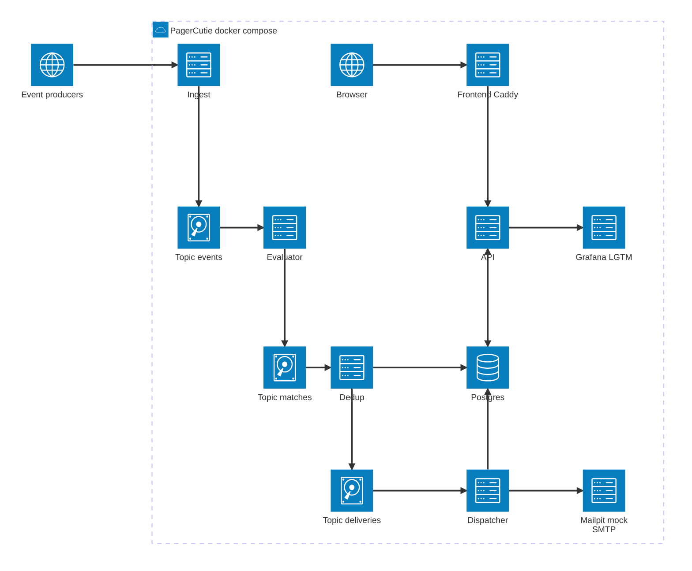

# PagerCutie — Specification

PagerCutie is a notification router and policy evaluator. It ingests events from many sources in arbitrary,
runtime-defined formats, evaluates team-defined rules against them, and delivers alerts to the right people
on the channels they prefer, together with the runbook steps needed to resolve them.

It is multi-user, multi-team and multi-source.

This document describes **how** PagerCutie works. **What** it must do is listed in
[REQUIREMENTS.md](REQUIREMENTS.md); requirement IDs (e.g. `RUL-1`) refer to that file.

---

## 1. Problem and goals

Systems produce errors, warnings and business events (a failed workflow, a breached threshold, a rejected
message). Today these signals are scattered across logs, dashboards and mailboxes, so the right people either
find out too late or receive so many alerts that they stop reading them.

PagerCutie MUST get **the right alert to the right people, on the channel they prefer**, and help them
**resolve it by following the team's runbooks**.

Guiding qualities:

| Quality     | Meaning                                                                    |
|-------------|----------------------------------------------------------------------------|
| Flexibility | Easy to adopt for any team or system.                                      |
| Scalability | A high volume of messages and alerts must not degrade service performance. |
| UX          | Usable by engineers, on-call support, and non-engineers alike.             |

## 2. Glossary

| Term            | Definition                                                                                              |
|-----------------|---------------------------------------------------------------------------------------------------------|
| **Source**      | An origin of events: a message broker topic, an HTTP/webhook endpoint, a tailed log file, a polled API. |
| **Event**       | A single raw message received from a source.                                                            |
| **Envelope**    | The internal wrapper around an event: ID, source, schema, timestamps, raw payload (§4.2).               |
| **Schema**      | A runtime-defined description of an event's structure, types and value constraints (JSON Schema).      |
| **Rule**        | A condition over event fields plus dedup, routing, presentation and runbook settings.                   |
| **Match**       | The fact that one event satisfied one rule. Input to deduplication.                                     |
| **Fingerprint** | Hash of a rule's dedup fields taken from the event. Matches with the same rule and fingerprint are the same alert. |
| **Alert**       | Created from the first match of a fingerprint. Has a lifecycle: open → acknowledged → resolved.         |
| **Delivery**    | One attempt to notify one recipient about one alert on one channel. Has a status.                       |
| **User**        | A person who can receive alerts.                                                                         |
| **Team**        | A named group of users. Teams own rules.                                                                 |
| **Recipient**   | A user or team that an alert is routed to.                                                               |
| **Channel**     | A delivery medium: Email, SMS, Phone call, UI.                                                           |
| **Runbook**     | Instructions attached to a rule, schema or alert type describing how to resolve an alert.                |
| **Action**      | An executable runbook step (retry workflow, restart service, call webhook, …).                           |

## 3. Architecture

### 3.1 Topology



Reading the diagram:

- The **hot path** runs top-left to bottom-right: producers → ingest → `events` → evaluator → `matches` →
  dedup → `deliveries` → dispatcher → channels. All three topics live in one **Redpanda** broker (§5).
- **Postgres** holds the low-volume state: rules, schemas, alerts, deliveries, audit log. Evaluator and
  ingest also read rules and schemas from it into memory (edges not drawn).
- **Every process** exports OpenTelemetry data to Grafana LGTM; only the API edge is drawn.
- SMS and phone are simulated: the dispatcher writes them to Postgres, and the UI shows them in a "fake phone"
  panel. Email goes to Mailpit, which has its own web inbox.

### 3.2 Process roles

The backend is **one codebase and one Docker image** (a "modular monolith"). It starts in different roles:

| Role         | Does                                                                          | State            | Scales by                    |
|--------------|-------------------------------------------------------------------------------|------------------|------------------------------|
| `ingest`     | Source adapters → schema resolution and validation → produce to `events`      | None             | Replicas behind Caddy        |
| `evaluator`  | Consume `events` → evaluate rules → produce one message per match to `matches` | Rules in memory  | Replicas, ≤ partitions       |
| `dedup`      | Consume `matches` → dedup windows → upsert alert in Postgres → produce to `deliveries` | Dedup windows in memory, per partition | Replicas, ≤ partitions |
| `dispatcher` | Consume `deliveries` → throttle per recipient → send via channel adapter → retries | Throttle counters in memory, per partition | Replicas, ≤ partitions |
| `api`        | REST API for the UI, SSE live feed, auth, audit log, action approvals         | None             | Replicas behind Caddy        |

Run modes:

```
backend --role=ingest|evaluator|dedup|dispatcher|api   # production / demo: one role per container
backend --role=worker                                  # evaluator + dedup + dispatcher in one process
backend --role=all                                     # local dev: everything in one process, in-memory queue
```

All roles talk to the queue through one `Queue` interface with two implementations: Redpanda and in-memory.
`--role=all` therefore needs only Postgres, and runs the same code as the distributed setup.

### 3.3 Technology

| Concern          | Choice                                                                                  |
|------------------|-----------------------------------------------------------------------------------------|
| Backend          | Python 3.14, FastAPI, SQLAlchemy (async) + Alembic, Pydantic                            |
| Broker           | Redpanda (Kafka API), Python client `confluent-kafka`                                   |
| Database         | PostgreSQL 18 (`jsonb` for event payloads, rule ASTs and schemas)                       |
| Event validation | JSON Schema 2020-12, validated with `jsonschema-rs` (same Rust engine as the later Rust port) |
| Frontend         | React 19, TanStack Router + Query, Tailwind, `orval`-generated API client, served by Caddy |
| Observability    | OpenTelemetry → `grafana/otel-lgtm` (Grafana, Prometheus, Tempo, Loki)                  |
| Email mock       | Mailpit                                                                                 |
| Later            | Hot paths ported to Rust: first the evaluator as a PyO3 module, then whole roles        |

## 4. Contracts

All contracts live in `contract/`. Generated code is never edited by hand. CI regenerates every artifact and
fails if the committed file differs (same pattern as the existing `mise run contract:check`).

| Contract             | Between                              | Format                    | File                                  |
|----------------------|--------------------------------------|---------------------------|---------------------------------------|
| Broker messages      | ingest → evaluator → dedup → dispatcher | Protobuf                | `contract/messages.proto`             |
| Rule AST             | frontend builder ↔ API ↔ evaluator   | JSON Schema 2020-12       | `contract/rule.schema.json`           |
| Evaluator test cases | Python evaluator ↔ Rust evaluator    | JSON fixtures             | `contract/rule-tests/*.json`          |
| Management API       | frontend ↔ API                       | OpenAPI 3.1               | `contract/openapi.json`               |
| User event schemas   | users → ingest                       | JSON Schema, **stored as data** in Postgres | none (runtime data) |

### 4.1 Compatibility rules

- Changes MUST be **additive**: add fields, never rename, retype or reuse them. Consumers ignore unknown fields.
- Deploy **consumers before producers** when a message gains a field.
- Protobuf: never change or reuse a field number; delete a field by marking it `reserved`.

### 4.2 Broker messages: `contract/messages.proto`

```proto
syntax = "proto3";
package pagercutie.v1;

// Topic `events`, produced by ingest.
message Event {
  string event_id       = 1;  // UUIDv7, assigned by ingest
  string source         = 2;  // source instance ID from config, e.g. "payments-webhook"
  string schema_id      = 3;  // resolved by ingest (§7)
  int64  received_at_ms = 4;  // ingest time; basis for end-to-end latency
  bytes  payload        = 5;  // event body as JSON, whatever the original wire format was
}

// Topic `matches`, produced by the evaluator. One per (event, matching rule).
message Match {
  string event_id       = 1;
  string rule_id        = 2;
  string fingerprint    = 3;  // hex SHA-256 of the rule's dedup field values (§9)
  int64  received_at_ms = 4;  // copied from Event
  bytes  payload        = 5;  // copied from Event, for templating
}

// Topic `deliveries`, produced by dedup.
message Delivery {
  string delivery_id    = 1;  // deterministic: hash(alert_id, recipient_id, channel, notification_seq)
  string alert_id       = 2;
  string recipient_id   = 3;
  string channel        = 4;  // "email" | "sms" | "phone" | "ui"
  int64  received_at_ms = 5;  // copied from the first Match
}
```

- `payload` is always **JSON** inside the pipeline. A source that receives protobuf (or anything else) decodes
  it to JSON in its adapter, so evaluator and dedup deal with one format only.
- Trace context is carried in the Kafka message **headers** (W3C `traceparent`), not in the messages, following
  OpenTelemetry's messaging conventions.
- Python code is generated with `protoc --python_out` plus `mypy-protobuf` stubs for type checking. Rust code
  is generated from the same file with `prost`.

### 4.3 Rule AST: `contract/rule.schema.json`

**Source of truth:** Pydantic models in the backend. FastAPI includes them in `contract/openapi.json`, so
`orval` generates the TypeScript types and zod validators for the visual builder. The standalone
`contract/rule.schema.json` is exported from the same models for the Rust port and for tools. The API
validates every rule before saving it, so the evaluator never sees an invalid AST.

A condition is a tree of three node types:

| Node      | Shape                                     | Meaning                         |
|-----------|-------------------------------------------|---------------------------------|
| Group     | `{"op": "and" \| "or", "args": [ … ]}`    | All / any child is true         |
| Not       | `{"op": "not", "arg": { … }}`             | Negation                        |
| Predicate | `{"field": "…", "cmp": "…", "value": …}`  | Compare one event field         |

Shape of the schema (the generated file is authoritative):

```json
{
  "$schema": "https://json-schema.org/draft/2020-12/schema",
  "$id": "urn:pagercutie:rule-condition:v1",
  "$ref": "#/$defs/condition",
  "$defs": {
    "condition": {
      "oneOf": [{ "$ref": "#/$defs/group" }, { "$ref": "#/$defs/not" }, { "$ref": "#/$defs/predicate" }]
    },
    "group": {
      "type": "object",
      "required": ["op", "args"],
      "additionalProperties": false,
      "properties": {
        "op": { "enum": ["and", "or"] },
        "args": { "type": "array", "minItems": 1, "items": { "$ref": "#/$defs/condition" } }
      }
    },
    "not": {
      "type": "object",
      "required": ["op", "arg"],
      "additionalProperties": false,
      "properties": { "op": { "const": "not" }, "arg": { "$ref": "#/$defs/condition" } }
    },
    "field": { "type": "string", "pattern": "^[A-Za-z_][A-Za-z0-9_]*(\\.[A-Za-z0-9_]+)*$" },
    "scalar": { "type": ["string", "number", "boolean", "null"] },
    "predicate": {
      "type": "object",
      "required": ["field", "cmp"],
      "properties": { "field": { "$ref": "#/$defs/field" } },
      "oneOf": [
        {
          "required": ["value"],
          "properties": { "cmp": { "enum": ["eq", "ne", "contains"] }, "value": { "$ref": "#/$defs/scalar" } }
        },
        {
          "required": ["value"],
          "properties": { "cmp": { "enum": ["gt", "gte", "lt", "lte"] }, "value": { "type": ["number", "string"] } }
        },
        {
          "required": ["value"],
          "properties": {
            "cmp": { "enum": ["in", "not_in"] },
            "value": { "type": "array", "minItems": 1, "items": { "$ref": "#/$defs/scalar" } }
          }
        },
        {
          "not": { "required": ["value"] },
          "properties": { "cmp": { "const": "exists" } }
        }
      ],
      "unevaluatedProperties": false
    }
  }
}
```

**Fields** are dot paths into the normalised event `{"source": …, "schema_id": …, "body": { … }}`, e.g.
`source`, `body.amount`, `body.error.code`.

**Example**, the brief's `amount > 1,000,000` and `error.code in [TIMEOUT, REJECTED]`, critical only:

```json
{
  "op": "and",
  "args": [
    { "field": "body.severity", "cmp": "eq", "value": "critical" },
    { "op": "or", "args": [
      { "field": "body.amount", "cmp": "gt", "value": 1000000 },
      { "field": "body.error.code", "cmp": "in", "value": ["TIMEOUT", "REJECTED"] }
    ]}
  ]
}
```

A full **rule** wraps the condition with its other parts (§8):

```json
{
  "id": "r-7",
  "team_id": "payments",
  "name": "Large or failed payments",
  "enabled": true,
  "schema_ids": ["payments.v1"],
  "condition": { "…": "as above" },
  "dedup": { "fields": ["body.workflow", "body.error.code"], "window_s": 300 },
  "routing": { "recipients": [{ "type": "team", "id": "payments" }], "channels": null },
  "presentation": {
    "title": "Payment {{body.workflow}} failed: {{body.error.code}}",
    "body": "Amount {{body.amount}} in {{body.environment}}",
    "fields": ["body.amount", "body.environment"],
    "severity": "critical",
    "colour": "red"
  },
  "runbook_id": "rb-payments-timeout"
}
```

`routing.channels: null` means "use each recipient's channel preferences for this severity" (`DEL-2`).

### 4.4 Management API

- FastAPI generates the OpenAPI document. `mise run contract` exports it to `contract/openapi.json`.
- The frontend's API client, TypeScript types and zod schemas are generated from it with `orval`.
- Errors use one JSON error format across all endpoints.

### 4.5 No gRPC between internal services

Internal services communicate **only through the broker and Postgres**. The broker gives buffering,
durability and key-based routing (§5). Synchronous gRPC calls between services would give none of these,
and would add a call chain that has to be available end to end.

gRPC MAY still be added as an **ingest source adapter**: an external system pushing protobuf events over gRPC
is one more source type (§6), decoded to the JSON envelope like every other source.

## 5. Messaging

### 5.1 Topics

| Topic        | Producer   | Consumer group | Partition key                 | Why this key                                                         |
|--------------|------------|----------------|-------------------------------|----------------------------------------------------------------------|
| `events`     | ingest     | `evaluator`    | none (spread evenly)          | Evaluation is stateless; any worker can take any event.              |
| `matches`    | evaluator  | `dedup`        | `rule_id:fingerprint`         | Every occurrence of the same alert reaches the same dedup worker.    |
| `deliveries` | dedup      | `dispatcher`   | `recipient_id`                | Per-recipient throttling sees all deliveries for that recipient.     |
| `events-dlq` | ingest     | none (inspected manually) | none               | Events that failed schema resolution or validation.                 |

- **12 partitions** per topic, fixed from the start. Changing the count remaps keys (`hash(key) % P`) and
  resets in-memory windows.
- Dev and demo: one Redpanda node, replication factor 1. Production: 3 nodes, replication factor 3,
  `min.insync.replicas=2`. Only configuration differs.

### 5.2 Routing and affinity

Three independent mappings:

| Mapping              | Depends on                         | Changes when…                    |
|----------------------|------------------------------------|----------------------------------|
| key → partition      | `hash(key) % P`                    | the partition count changes      |
| partition → worker   | consumer group membership          | a **worker** joins or leaves     |
| partition → broker   | partition leader election          | a **broker** joins or leaves     |

Because each partition is read by exactly one worker of the group at a time, dedup windows and throttle
counters can live **in worker memory**, with no shared store on the hot path.

- **A broker leaves:** new leaders are elected for its partitions. Clients refresh metadata and continue on
  the same partitions. Keys and worker assignments do not change, so in-memory state stays valid.
- **A worker leaves:** its partitions move to other workers, which start with empty windows. Static
  membership (`group.instance.id`) gives a restarted worker the same partitions back without a rebalance.
  The Postgres upsert on open alerts (§9) catches any duplicate after a real rebalance.

### 5.3 Delivery semantics

**At-least-once** end to end, made safe by idempotent consumers:

1. A consumer processes a message, writes its results (Postgres and/or the next topic), and **only then
   commits** the offset.
2. If it crashes in between, the message is processed again. Alert upserts (by fingerprint) and delivery
   inserts (by `delivery_id`) are idempotent, so reprocessing creates no duplicates.

### 5.4 Client configuration

```python
PRODUCER = {"acks": "all", "enable.idempotence": True, "linger.ms": 1}
CONSUMER = {
    "group.instance.id": os.environ["WORKER_ID"],           # static membership
    "partition.assignment.strategy": "cooperative-sticky",
    "session.timeout.ms": 30000,
    "enable.auto.commit": False,
}
```

Every worker shuts down gracefully on `SIGTERM`: stop polling, flush in-memory counters, commit offsets, exit.

## 6. Sources

*Satisfies `ING-1`, `ING-2`.*

- Every source type implements one **source adapter** interface: receive raw input, return
  `(source_id, raw_payload)`. Adding a source type means writing one adapter.
- Adding a new **instance** of an existing type (another webhook path) is configuration only.
- Initial adapters: **HTTP webhook** and **WebSocket**. Planned: **protobuf** (over HTTP, possibly gRPC).
- Ingest replies to a webhook only after the broker confirmed the write (`acks=all`), so an accepted event is
  never lost.

## 7. Events and schemas

*Satisfies `SCH-1` – `SCH-3`.*

- Event schemas are **JSON Schema 2020-12 documents stored in Postgres**, created and changed at runtime.
  JSON Schema covers `SCH-3`: sub-schemas (`$defs` / `$ref`), types (primitive, array, object) and
  type-dependent constraints (`maxLength`, `minimum`, `minItems`, …).
- Ingest compiles each schema once and caches it; it reloads on Postgres `NOTIFY schemas_changed`.
- Events that fail validation go to `events-dlq` and increment `events_rejected_total{reason}`.
- Ingest does not store events in Postgres. The `events` topic is the raw log, with time-based retention.

## 8. Rules

*Satisfies `RUL-1` – `RUL-5`.*

| Part             | Contents                                                                    |
|------------------|-----------------------------------------------------------------------------|
| **Condition**    | AST of AND / OR / NOT groups and predicates (§4.3).                         |
| **Dedup**        | Fields forming the fingerprint, window length (§9).                         |
| **Routing**      | Recipients; channels, or `null` to use the recipients' preferences.        |
| **Presentation** | Title and body templates, included fields, severity, UI colour.             |
| **Runbook**      | Optional runbook attachment (§11).                                          |

- Rules are edited in the **visual builder**, which produces the AST directly. A textual syntax MAY be added
  later on top of the same AST.
- Rules are stored in Postgres and changed through the API (`RUL-5`). Evaluators cache all enabled rules in
  memory, compiled once to closures, and reload on `NOTIFY rules_changed`. No restart is needed.

### 8.1 Evaluator semantics

The evaluator is a pure function `(rule, event) → bool`. It is **total**: it never raises on any input.

- A predicate on a **missing field** is `false`, except `exists`.
- A predicate with a **type mismatch** (e.g. `gt` on a string field against a number) is `false`.
- `not` negates the result above, so `not(eq)` is `true` for a missing field. This is intended.
- `contains`: substring for strings, membership for arrays, `false` otherwise.
- `gt`/`gte`/`lt`/`lte` compare numbers with numbers and strings with strings (ISO timestamps sort correctly).

The cases in `contract/rule-tests/*.json` (`{rule, event, expected}`) MUST pass in every evaluator
implementation, Python and Rust.

## 9. Noise reduction

*Satisfies `NOI-1`, `NOI-2`.*

- **Fingerprint:** `sha256(rule_id + values of rule.dedup.fields)`. An empty field list means one alert per
  rule per window.
- **Deduplication** (dedup role): the first match of a fingerprint within `window_s` upserts an alert in
  Postgres and produces the deliveries. Later matches only increment an in-memory counter, flushed to the
  alert row every 5 s. 500 identical errors cost about two Postgres writes, not 500.
- A partial unique index on the fingerprint of **open** alerts makes the upsert idempotent and catches
  duplicates after a worker rebalance.
- **Throttling** (dispatcher role): a per-recipient token bucket in memory, possible because `deliveries` is
  keyed by `recipient_id`. Throttled deliveries are grouped into a digest instead of being dropped.

## 10. Delivery

*Satisfies `DEL-1` – `DEL-6`.*

- Every channel implements one **channel adapter** interface. Replacing a simulated provider with a real one
  touches only that adapter (`DEL-4`).

  | Channel | Adapter for the demo                                    |
  |---------|---------------------------------------------------------|
  | Email   | SMTP to Mailpit                                         |
  | SMS     | Simulated: row in Postgres, shown in the UI phone panel |
  | Phone   | Simulated: row in Postgres, shown in the UI phone panel |
  | UI      | Row in Postgres + `NOTIFY`, pushed to the browser over SSE |

- The dispatcher inserts each delivery as `pending` (idempotent by `delivery_id`) before sending, then marks
  it `sent` or `failed` (`DEL-6`).
- **Retries:** failed deliveries get `retry_at` with exponential backoff. A retry loop in the dispatcher picks
  them up with `SELECT … FOR UPDATE SKIP LOCKED`, so a channel that is down for a long time never blocks the
  partition and no delivery is lost (`DEL-5`).

## 11. Runbooks and actions

*Satisfies `RUN-1` – `RUN-7`.* — TBD.

## 12. Backend and frontend

### 12.1 API

- FastAPI, structured like the existing scaffold: one package per entity with `router` → `service` →
  `models`. Routers never import models.
- Entities: teams, users, channel preferences, sources, schemas, rules, runbooks, alerts, deliveries, audit
  log.
- **Live feed (`UI-1`):** Server-Sent Events, already used by the scaffold (`EventSourceResponse`). Each API
  replica listens to Postgres `NOTIFY alert_changed` and pushes the change to its connected browsers. SSE is
  enough because the feed is one-way; acknowledge and resolve are ordinary REST calls.
- Every state change by a user (acknowledge, resolve, approve an action, edit a rule) is written to an
  append-only `audit_log` table in the same transaction (`RUN-5`).

### 12.2 Persistence

- PostgreSQL 18 with SQLAlchemy (async). Schema changes go through Alembic migrations, applied by the one-shot
  `migrate` compose service before anything else starts.
- `jsonb` columns for rule conditions, event schemas and alert payload snapshots.
- Migrations MUST be backward-compatible (expand first, contract later), so roles can be updated one at a
  time.

### 12.3 Frontend

- React 19, TanStack Router and Query, Tailwind. The API client is generated by `orval` from
  `contract/openapi.json`.
- Served by Caddy, which also proxies `/api/*` to the API, so the browser has a single origin.
- Main views: live alert feed, alert detail (runbook, actions, history), rule builder, channel preferences,
  simulated phone panel.

## 13. Observability

The scaffold already exports OpenTelemetry to `grafana/otel-lgtm` (`--profile observability`).

| Signal  | What                                                                                                     |
|---------|----------------------------------------------------------------------------------------------------------|
| Metrics | `events_ingested_total{source}`, `events_rejected_total{reason}`, `rule_eval_duration_seconds`, `alerts_created_total`, `deliveries_total{channel,status}`, `delivery_retries_total`, consumer lag per partition |
| Latency | `end_to_end_latency_seconds` histogram: `now - received_at_ms`, recorded when a delivery is sent. Grafana shows **p50 / p99** (`NFR-3`). |
| Traces  | One trace per event across all roles, propagated through Kafka headers.                                 |
| Logs    | Structured JSON (structlog) with `event_id`, `alert_id`, `rule_id`, `trace_id`.                          |
| Health  | `/health` on every role, used by compose healthchecks.                                                   |

A Grafana dashboard is committed to the repo. It is used live in the video while the load test runs and
workers are scaled.

## 14. Open questions

- **`UI-4`:** what does "propose fixes / enhancements to the alerts" mean? Users suggesting changes to a rule,
  template or runbook (review-style)? System-generated suggestions (e.g. "this rule is noisy, raise the
  threshold")? To be clarified with the mentors.
- **Schema resolution:** is an event's schema fixed per source instance, or chosen by a discriminator field
  in the payload? Proposal: per source instance, with an optional discriminator field in the source config.
- **"Problem goes away" (`RUN-5`):** how is this detected — a resolving event, absence of events for a
  period, or a health check?
- **Runbooks and actions (§11):** storage format, action executor role, approval flow.
